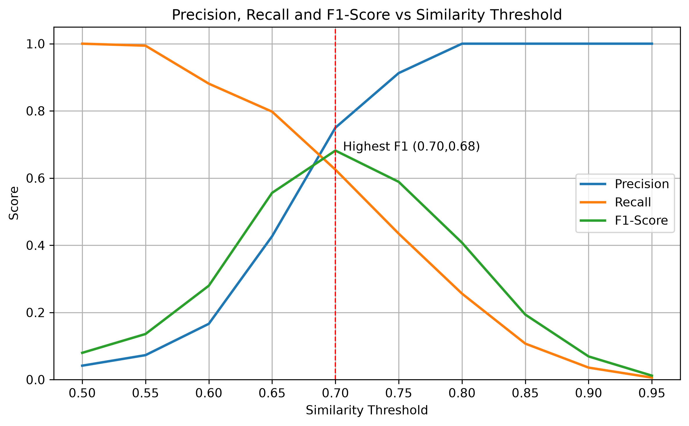

# Model Benchmarking & Threshold Evaluation Report
## 1. Executive Summary
Based on the comparison of the three embedding models (`all-minilm`, `nomic-embed-text`, and `bge-m3`), only `bge-m3` passed the first evaluation test. In general, the models exhibited index build and query latencies ranging from approximately 5 to 13 milliseconds, indicating that index construction and nearest-neighbor search introduce minimal computational cost. However, embedding generation required approximately 3-4 seconds per 100 texts, making it the dominant contributor to the overall execution time. Although `bge-m3` has the highest embedding latency with approximately 4.2 seconds, its superior semantic matching performance outweighs the additional preprocessing cost. Therefore, `bge-m3` was selected as the embedding model for the remainder of the project. 

To identify the optimal similarity threshold, the model was evaluated using thresholds ranging from 0.50 to 0.95. A threshold of **0.70** achieved the highest F1-score, providing the best balance between minimizing false matches and preserving true duplicate log messages.

## 2. Model Comparison Table
The table below presents the benchmark results of the three models. Latency measurements and RAM usage were calculated by taking the average of 100 trials, as these values may vary between individual runs.

| Model Name | Size (MB) | Vector Dimension | Embedding Latency per 100 items (ms) | Index Build Time (ms) | Query Latency (ms) | ANN Recall | RAM Usage (MB) |
|------------|----------:|-----------------:|-------------------------------------:|----------------------:|-------------------:|-----------:|---------------:|
| all-minilm | 45 | 384 | 3085.99 | 6.25 | 6.08 | 100.00% | 1.20 |
| nomic-embed-text | 274 | 768 | 3542.60 | 10.15 | 9.69 | 100.00% | 1.57 |
| bge-m3 | 1229 | 1024 | 4286.63 | 13.13 | 12.41 | 100.00% | 1.74 |

> These measurements are hardware and environment-dependent and may vary across different computers.

The three models trade off vector size for speed and accuracy. `all-minilm` is the smallest and fastest, but `bge-m3` produces larger, higher-quality vectors that catch matches that the smaller models miss, at the cost of approximately 40% higher embedding latency and 45% more RAM. Index build and query times grow a bit with vector size too, but all three stay under 15ms, so they're not a real bottleneck compared to embedding generation. `bge-m3` was still chosen because catching those extra matches mattered more than the added cost.

## 3. Threshold Performance Analysis
### Evaluation Metrics vs. Thresholds
The graph below shows the change in the semantic match precision, recall and F1-Score as similarity threshold increases from 0.50 to 0.95.

    

Precision goes up and recall goes down as the threshold increases. A higher threshold means the model only matches logs it's very sure about, so it makes fewer mistakes but also misses more real matches. The two lines cross around **0.70**, which is also where F1-score peaks, making it the best balance point.

### Edge-Case Failures
At a similarity threshold of **0.70**, the model was evaluated on **6216** record pairs. The confusion matrix contained **33** incorrect merges where logs from different anomaly categories were considered similar, and **61** missed merges where logs describing the same anomaly were not matched.

**False Merge Examples**

| Log A | Log B | True Categories |
|---|---|---|
| "Database schema migration failed" | "schema validation failed" | `schema_migration_failed` vs. `invalid_input_format` |
| "Failed to apply schema changes to database" | "schema validation failed" | `schema_migration_failed` vs. `invalid_input_format` |
| "User session token is no longer valid" | "Token signature verification failed" | `auth_token_expired` vs. `token_signature_invalid` |

False merges tend to happen when two logs share common words (like "schema", "token", or "failed") even though they come from different root causes. In these short sentences, the model seems to focus more on the shared words than on the actual meaning.

**Missed Merge Examples**

| Log A | Log B | Shared Group |
|---|---|---|
| "Connection timed out when connecting to DB host db-prod-01" | "Failed to connect to the database: connection timeout" | `db_connection_timeout` |
| "DB connection request failed due to timeout error" | "Timeout occurred while establishing connection to db-prod-01 at \<TIME\>" | `db_connection_timeout` |
| "NullPointerException: user profile is null" | "NPE: Null value dereferenced for profile object" | `null_pointer` |

Missed merges happen for two main reasons. First reason is heavy rewording, sometimes combined with sanitization artifacts like the leftover `<TIME>` tag, pushes the similarity score just under the 0.70 cutoff even though both logs describe the same issue and secondly, abbreviations (like "NPE" vs. "NullPointerException") are harder for the model to match without more context.

**Implications**

False merges are risky because they group unrelated issues together, which can mislead troubleshooting. Missed merges are less risky but create multiple entries for the same issue, adding noise to the output. The threshold of 0.70 was chosen because it balances these two problems best, based on the F1-score curve above. Still, some errors of both kinds are expected, since similarity scores alone can't fully capture root-cause differences.

## 4. Pre-Processing Impact
To measure the effect of preprocessing, the same evaluation dataset was embedded twice with `bge-m3` at threshold=0.70: once using the raw log text, and once using text passed through `sanitize()` (stripping timestamps, IPs, UUIDs, hex addresses, thread/worker identifiers, and key=value noise fields).

| Metric | Raw Data | Pre-Processed Data | Change |
|--------|---------:|-------------------:|-------:|
| Precision | 89.86 % | 89.87 % | +0.01 % |
| Recall | 36.90 % | 42.26 %| +5.36 %|
| F1-Score | 52.32 %| 57.49 %| + 5.17 %|
| True Positives | 62 | 71 | +9 |
| False Positives | 7 | 8 | +1 |
| False Negatives | 106 | 97 | -9 |

Sanitization's main effect is on **recall**. Removing dynamic noise allowed the model to correctly match 9 more pairs of logs that describe the same issue but were previously scored just below the similarity threshold due to the noise. Precision was essentially unaffected (+0.01 pt), and only one additional false positive was introduced, a negligible cost relative to the recall gain.

---